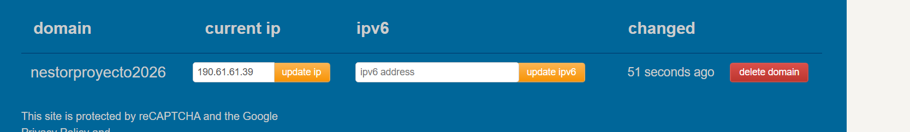

# Secure Web System as an Enterprise Risk Control

React + Auth0 → access token Bearer → Spring Boot Resource Server. En producción: Duck DNS → Apache con TLS → frontend estático y proxy `/api/` hacia `127.0.0.1:8080`.

**URL HTTPS desplegada: pendiente de configuración y verificación.** Esta entrega no acredita todavía despliegue público ni login con un tenant real.

**Configuración actual:** tenant y Client ID recibidos e incorporados. Hostname previsto `nestorproyecto2026.duckdns.org`, DNS A comprobado hacia `190.61.61.39`. Para tu entorno **Windows + Docker Desktop + WSL 2**, usa `scripts/Start-Docker.ps1`. WSL `docker-desktop` Running versión 2 confirmado por la salida del usuario; no se requiere Ubuntu ni sudo para esa ruta. El Compose nuevo no publica 8080. El contenedor existente `virtualization-lab` publica 8080 hacia su puerto 9000 y se conserva sin cambios.

**Bloqueo Auth0 comprobado:** el login devuelve `invalid_request`: la SPA no está autorizada para `https://enterprise-risk-api`. Concede User-Delegated Access con `read:risk` en la SPA → APIs. HTTP/HTTPS públicos respondieron conexión rechazada desde este entorno; no se declara despliegue.

Se reutilizó el backend original del estudiante (paquete, clase principal, Maven y Java objetivo 21). Esta es ahora la carpeta principal en Descargas. El código anterior se conserva en `legacy-original/`, fuera del build y excluido de Git. El proyecto activo contiene `backend/`, `frontend/`, `deploy/`, `scripts/`.

## Requisitos locales

- JDK 21 y Maven 3.9+ (o Maven Wrapper incluido).
- Node 22.12+ y pnpm 11 (verificado con 11.25.0). Se incluye `pnpm-lock.yaml`; usa `pnpm install --frozen-lockfile`. Como alternativa, npm puede instalar `package.json`, aunque no reutiliza el lock de pnpm.
- Configuración pública real de Auth0: Domain, Client ID y audiencia `https://enterprise-risk-api`.

## Auth0

API `Enterprise Risk Lab API`, RS256, Identifier `https://enterprise-risk-api`, permiso `read:risk`. SPA `Enterprise Risk Lab Frontend`, con User-Delegated Access a la API y `read:risk`. Añade `http://localhost:5173` en callbacks, logout y web origins; añade el origen HTTPS exacto cuando exista. Crea un usuario y habilita su conexión para la SPA.

Los identificadores públicos no son secretos. Ninguna SPA debe incluir un client secret.

## Ejecutar backend en PowerShell

Desde `backend/`:

```powershell
$env:AUTH0_ISSUER_URI='https://dev-r6i45jdjr8aj2uk6.us.auth0.com/'
$env:AUTH0_AUDIENCE='https://enterprise-risk-api'
$env:CORS_ALLOWED_ORIGINS='http://localhost:5173'
$env:SERVER_PORT='8081'
.\mvnw.cmd spring-boot:run
```

En Linux exporta esas mismas variables y usa `bash mvnw spring-boot:run`. Un Maven instalado puede ejecutar `mvn spring-boot:run`. El issuer requiere HTTPS y `/` final; la URL JWKS se deriva como `ISSUER + .well-known/jwks.json`. El archivo `.env.example` es documentación: Spring/Maven no lo cargan automáticamente. Sin issuer, el arranque falla en vez de usar un tenant inventado.

```powershell
curl.exe -i http://127.0.0.1:8081/api/risk-status
# Esperado: 401 Unauthorized
curl.exe --fail http://127.0.0.1:8081/actuator/health
# Esperado: {"status":"UP"}
```

## Ejecutar frontend

Desde `frontend/`:

```powershell
Copy-Item .env.example .env.local
# El ejemplo ya contiene el Domain y Client ID públicos recibidos.
pnpm install --frozen-lockfile
pnpm dev
```

Abre `http://localhost:5173`, inicia sesión y pulsa **Consultar API protegida**. Se espera HTTP 200 y JSON con `status`, `subject` y `control`. La UI mantiene el token en memoria y nunca lo muestra. Si faltan datos, presenta instrucciones de configuración; esa pantalla no es evidencia de autenticación.

| Variable | Uso |
|---|---|
| `AUTH0_ISSUER_URI` | Backend: `https://TU_TENANT.us.auth0.com/` |
| `AUTH0_AUDIENCE` | Backend: `https://enterprise-risk-api` por defecto |
| `CORS_ALLOWED_ORIGINS` | Backend: orígenes exactos separados por coma; solo HTTPS en producción |
| `VITE_AUTH0_DOMAIN` | Frontend: dominio sin esquema ni `/` |
| `VITE_AUTH0_CLIENT_ID` | Frontend: identificador público de la SPA |
| `VITE_AUTH0_AUDIENCE` | Frontend: `https://enterprise-risk-api` |
| `VITE_API_URL` | `http://localhost:8081` en local para evitar el otro laboratorio; vacío para mismo origen en producción |

Las variables Vite se incorporan al build; cambiar el archivo sin reconstruir no cambia el frontend publicado. No pongas secretos en ninguna variable `VITE_`.

## Pruebas y compilación

```powershell
# backend/
.\mvnw.cmd clean verify
# frontend/
pnpm test
pnpm build
```

Las pruebas backend hacen peticiones HTTP reales: 401 sin token, token malformado, firma falsa, emisor incorrecto, audiencia incorrecta y token expirado; 200 con firma válida; salud pública; preflight CORS permitido/rechazado; ruta administrativa denegada. El token temporal válido es exclusivo de pruebas y su clave privada solo existe en memoria.

Frontend: envío del encabezado y URL, 401 con cuerpo vacío, ocultación de errores arbitrarios, JSON inválido y fallo al obtener credenciales. No se automatiza un login con contraseñas reales.

## Alternativa de producción en servidor Ubuntu nativo

Esta alternativa es independiente de Docker Desktop. Los comandos sudo, systemd y apt siguientes solo corresponden a un servidor Ubuntu administrado directamente. En Windows con Docker Desktop usa `scripts/Start-Docker.ps1`.

1. Configura servidor Ubuntu, usuario sudo, DNS y firewall. Entrada pública 80/443, 8080 cerrado; administración restringida.
2. Copia `frontend/.env.production.example` a `.env.production.local` y completa Domain y Client ID reales. Mantén `VITE_API_URL=` vacío para usar el origen HTTPS de Apache. Si tienes `.env.local` con valores locales, quítalo temporalmente del contexto de compilación o asegúrate de que `.env.production.local` declare todas las variables; este último tiene prioridad.
3. Ejecuta `pnpm build` en frontend y `mvn clean verify` en backend con JDK 21.
4. Transfiere usando SCP la carpeta del proyecto a tu usuario de despliegue. Incluye `frontend/dist/`, `backend/target/secure_web_system_as_an_enterprise_risk_control-0.0.1-SNAPSHOT.jar` y `deploy/`; excluye node_modules, `.git`, cachés y archivos privados.

## Instalación inicial en Ubuntu

El script es para un servidor dedicado. Instala paquetes, crea el servicio y sitio; no cambia firewall ni DNS y rechaza sobrescribir una instalación existente. Revisa sus archivos antes de ejecutarlo. No ha sido ejecutado sobre infraestructura externa durante la preparación de esta entrega.

```bash
# Desde la raíz transferida, con valores REALES:
sudo bash deploy/install.sh TU-SUBDOMINIO.duckdns.org https://TU_TENANT.us.auth0.com/
sudo systemctl status enterprise-risk-api --no-pager
curl --fail http://127.0.0.1:8080/actuator/health
sudo ss -ltnp '( sport = :8080 )'
sudo apachectl configtest
```

El usuario `riskapi` no tiene login; el JAR es propiedad de root, legible por el servicio. systemd usa `/etc/enterprise-risk-api.env` y endurecimiento básico. Apache publica el frontend y solo reenvía `/api/`. La salud se comprueba desde el servidor.

## Emitir HTTPS y comprobar renovación

Con DNS apuntando al servidor y 80/443 accesibles:

```bash
sudo certbot --apache --redirect -d TU-SUBDOMINIO.duckdns.org
sudo apachectl configtest
sudo certbot certificates
sudo certbot renew --dry-run
systemctl list-timers --all
curl -Iv https://TU-SUBDOMINIO.duckdns.org/
curl -i https://TU-SUBDOMINIO.duckdns.org/api/risk-status
```

No uses `-k`: ocultaría errores del certificado. Verifica el temporizador de Certbot y que la prueba de renovación termine bien. No inicies sesión por HTTP público. Añade el origen HTTPS exacto a las tres listas de la SPA en Auth0.

Desde una red externa, ejecuta `scripts/verify-public.ps1 -Hostname TU-SUBDOMINIO.duckdns.org`. Comprueba la redirección HTTP con `curl -I http://TU-SUBDOMINIO.duckdns.org/`; se espera Location hacia HTTPS. La prueba del puerto 8080 desde una sola red es evidencia de ese punto de observación, complementada con el bind loopback y reglas del firewall.

## Operación y actualización

```bash
sudo journalctl -u enterprise-risk-api -n 50 --no-pager
sudo tail -n 50 /var/log/apache2/enterprise-risk-access.log
```

El servicio registra lecturas exitosas sin tokens ni identidad personal. Apache registra método, ruta sin query, estado y dirección de origen. No habilites DEBUG de OAuth/JWT ni añadas Authorization/cookies al formato de logs.

Para actualizar, guarda copia de la instalación actual, compila, detén el servicio, instala el nuevo JAR con propietario root y grupo riskapi/permisos 0640, reemplaza los estáticos de forma controlada, reinicia y verifica salud, 401 y login. El instalador inicial se detiene ante una instalación existente para que revises esa actualización.

## Resolución de errores

- **Client is not authorized:** SPA → APIs → API del taller → Edit → User-Delegated Access → Grant Access → read:risk. No basta Client Access.
- **401:** issuer HTTPS con `/` final; mismo tenant y audiencia exacta; reinicia backend y vuelve a iniciar sesión después de cambiar audiencia.
- **Fallo CORS:** desarrollo usa exactamente `http://localhost:5173`; revisa `CORS_ALLOWED_ORIGINS`. En producción usa mismo origen y solo el HTTPS real.
- **Salud no arranca:** `systemctl status` y `journalctl`; comprueba Java 21 y `/etc/enterprise-risk-api.env`.
- **Certbot falla:** revisa DNS A/AAAA, entrada 80/443, NAT y `apachectl configtest`; no inventes una evidencia de certificado válido.
- **JSON inesperado:** comprueba que `/api/` llega al proxy y no al fallback de React.

## Referencias técnicas

- [Spring Security: validación JWT](https://docs.spring.io/spring-security/reference/servlet/oauth2/resource-server/jwt.html)
- [Auth0 React: ejemplos oficiales](https://github.com/auth0/auth0-react/blob/main/EXAMPLES.md)
- [Apache: expresiones y REQUEST_SCHEME](https://httpd.apache.org/docs/current/expr.html)
- [Ubuntu: certificados TLS y renovación](https://ubuntu.com/server/docs/how-to/security/obtain-tls-certificates/)
- [pnpm: política de scripts de dependencias](https://github.com/pnpm/pnpm.io/blob/main/docs/settings/build.md)

## Capturas de pantalla

### Aplicaciones configuradas en Auth0


### Subdominio configurado en Duck DNS


